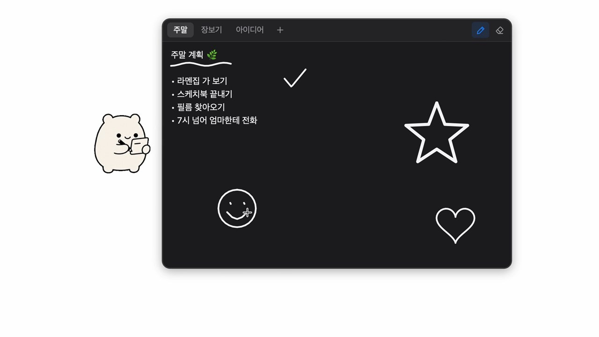

# MemoBuddy

**작업하던 화면에서 바로 쓰고 그리는 작은 펫 메모장.**

펫을 누르면 메모가 열리고, 다른 곳을 누르면 저장 후 닫힙니다. 메모 앱을 따로 찾아 열거나 저장 버튼을 누를 필요 없이, 떠오른 생각을 글과 그림으로 남길 수 있습니다.

[Windows 다운로드](https://apps.microsoft.com/detail/9mv1clqjv6cx) · [사용법](#사용법) · [문의·의견](https://github.com/tinkerer0/MemoBuddy/issues) · [English](#english)

Microsoft Store에 공개한 Windows 앱 화면.

## 사용법

1. [Microsoft Store](https://apps.microsoft.com/detail/9mv1clqjv6cx)에서 Windows 앱을 설치합니다.
2. 화면의 펫을 눌러 메모를 열고, 글을 쓰거나 그림을 그립니다.
3. 다른 곳을 누르면 메모가 저장되고 닫힙니다. 다시 펫을 누르면 이어서 쓸 수 있습니다.

## 주요 기능

| 기능 | 할 수 있는 일 |
| --- | --- |
| 글과 그림 | 한 메모 안에서 글을 쓰고 펜·지우개로 그리기 |
| 여러 메모 | 탭 추가·이름 변경·순서 변경·삭제 |
| 나만의 펫 | 기본 캐릭터 9종 또는 직접 고른 사진·GIF 사용 |
| 화면 설정 | 펫 크기 3단계, 화이트·다크 테마 |
| 로컬 저장 | 계정 없이 사용하고 메모를 내 컴퓨터에 보관 |

펫을 우클릭하거나 알림 영역에서 모양과 설정을 바꿀 수 있습니다. 기능과 배포 안내는 [Microsoft Store 페이지](https://apps.microsoft.com/detail/9mv1clqjv6cx)에서도 확인할 수 있습니다.

## 지원과 개인정보

- **문의·오류·제안**: [Issues](https://github.com/tinkerer0/MemoBuddy/issues). 앱 버전, 운영체제, 재현 방법을 함께 적어 주세요.
- **개인정보**: [개인정보 처리방침](docs/PRIVACY.md). MemoBuddy에는 계정·광고·추적 기능이 없으며 메모는 컴퓨터에 저장됩니다. Windows WebView2 진단 정보 등 상세 범위도 이 문서에서 안내합니다.
- **보안 문제**: [보안 신고 안내](SECURITY.md)의 비공개 신고 경로를 이용해 주세요.
- **사용한 구성 요소**: [오픈소스 라이선스](THIRD_PARTY_LICENSES.md).

## 이 저장소에 있는 것

앱 소개, 지원 창구, 개인정보 처리방침과 라이선스 문서를 관리합니다. 현재 앱의 소스 코드는 비공개입니다.

이전 이름은 **MemoPet**입니다. 이 저장소 이력에 남아 있는 이전 버전(초기의 Swift/AppKit MemoPet 포함)은 기존 [MIT 라이선스](LICENSE)로 제공됩니다.

## English

MemoBuddy is a small desktop pet that keeps your notes close. Click the pet to write or draw; click elsewhere to save and close. Use tabs for multiple notes, choose one of nine characters or your own image/GIF, and switch between light and dark themes.

[Download for Windows](https://apps.microsoft.com/detail/9mv1clqjv6cx) · [Support](https://github.com/tinkerer0/MemoBuddy/issues) · [Privacy](docs/PRIVACY.md) · [Security](SECURITY.md) · [Third-party licenses](THIRD_PARTY_LICENSES.md)

This repository contains product and support documentation. Current app source code is private. Earlier versions in the repository history, including the original Swift/AppKit MemoPet, remain available under the [MIT License](LICENSE).
