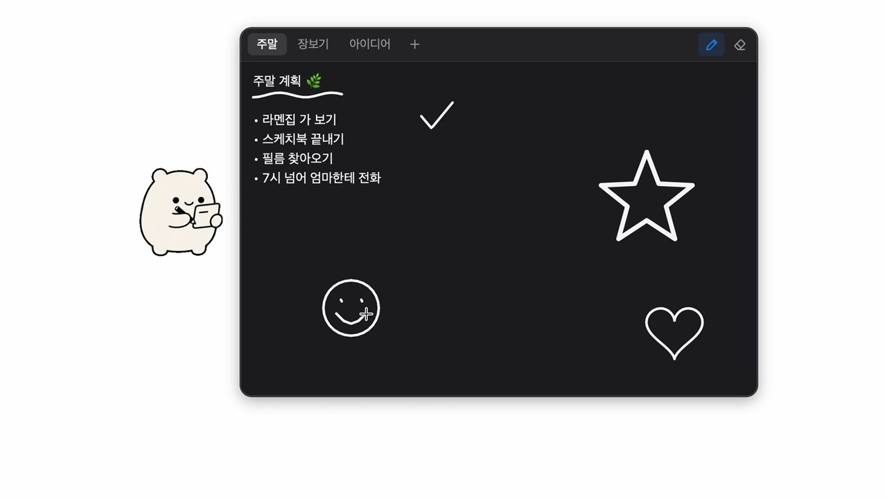

# MemoBuddy

English · [한국어](README.ko.md)

**A small pet notepad for writing and drawing right where you are working.**

Click the pet to open a note; click anywhere else to save and close it. You do not have to find a notes app or press a save button to capture a passing thought as text or a drawing.

[Mac App Store](https://apps.apple.com/app/id6818223612) · [Microsoft Store](https://apps.microsoft.com/detail/9mv1clqjv6cx) · [How to use](#how-to-use) · [Questions and feedback](https://github.com/tinkerer0/MemoBuddy/issues)

Screenshot of the Windows app. The macOS app has the same features.

## How to use

1. Install from the [Mac App Store](https://apps.apple.com/app/id6818223612) on macOS or the [Microsoft Store](https://apps.microsoft.com/detail/9mv1clqjv6cx) on Windows. Both are free.
2. Click the pet on your screen to open a note, then write or draw.
3. Click anywhere else and the note is saved and closed. Click the pet again to pick up where you left off.

## Features

| Feature | What you can do |
| --- | --- |
| Text and drawing | Write and draw with a pen and eraser in the same note |
| Multiple notes | Add, rename, reorder and delete tabs |
| Your own pet | Use one of 9 built-in characters or a photo or GIF you choose |
| Display settings | Three pet sizes, light and dark themes |
| Local storage | No account needed; notes are kept on your own computer |

Right-click the pet, or use the notification area, to change its look and settings. You can also find feature and distribution details on the [Mac App Store](https://apps.apple.com/app/id6818223612) and [Microsoft Store](https://apps.microsoft.com/detail/9mv1clqjv6cx) pages.

## Support and privacy

- **Questions, bugs, suggestions**: [Issues](https://github.com/tinkerer0/MemoBuddy/issues). Please include the app version, your operating system and steps to reproduce.
- **Privacy**: [Privacy policy](docs/PRIVACY.md). MemoBuddy has no accounts, ads or tracking, and notes are stored on your computer. The document also covers details such as Windows WebView2 diagnostic data.
- **Security issues**: Please use the private reporting channel described in the [security reporting guide](SECURITY.md).
- **Components used**: [Open-source licenses](THIRD_PARTY_LICENSES.md).

## What is in this repository

It holds the app introduction, the support channel, the privacy policy and license documents. The current app's source code is private.

The previous name was **MemoPet**. Earlier versions that remain in this repository's history, including the original Swift/AppKit MemoPet, are provided under the existing [MIT License](LICENSE).
